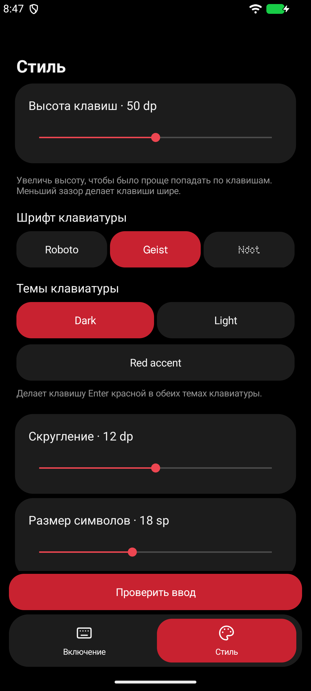
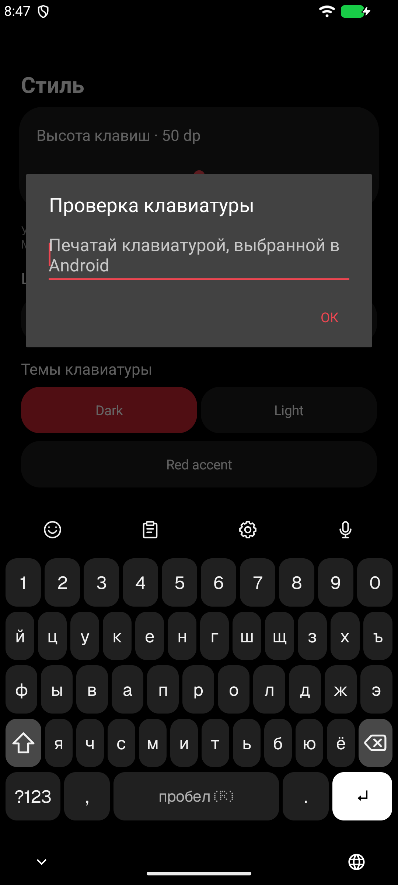

# Nothing Type

[Русский](README.md) · [English](README.en.md)

[](https://github.com/CVRSPOTTED/nothing-type/actions/workflows/android.yml)

An Android keyboard inspired by Nothing OS, with Russian and English layouts,
offline word suggestions and adjustable styling.

[Download APK 0.5.0](https://github.com/CVRSPOTTED/nothing-type/releases/download/v0.5.0/nothing-type-0.5.0-debug.apk) · [Releases](https://github.com/CVRSPOTTED/nothing-type/releases)

**0.5.0 is a preview build, signed with a debug key.**

| Settings | Keyboard |
| --- | --- |
|  |  |

## Features

- RU/EN layouts. Switch with a Space hold or a dedicated key.
- Offline suggestions and autocorrect. Backspace undoes a correction.
- 3,781 emoji, extra symbols and voice input.
- Dark and Light themes, a red Enter option, Roboto, Geist and Ndot font import.
- Adjustable key size, spacing and corner radius.
- Cursor control on Space and a moving background that responds to dictation.

## Install

Requires Android 8.0 or later.

1. Download and install the APK.
2. Open Nothing Type and tap **Enable Nothing Type**.
3. Tap **Select keyboard** and choose Nothing Type.

Open **Style** for settings. **Try typing** opens a keyboard test field.

## Privacy and limits

Suggestions run locally. Typed text is not saved as a history.
Voice input uses your system speech service, which may need internet access.
[Privacy policy, in Russian](PRIVACY.md)

Autocorrect uses a small built-in dictionary. Glide typing, a personal dictionary
and next-word prediction are planned.

## Build

Use JDK 17 and Android SDK 36.

```bash
git clone https://github.com/CVRSPOTTED/nothing-type.git
cd nothing-type
bash ./gradlew testDebugUnitTest :swipe-research:test lintDebug assembleDebug
```

On Windows, use `gradlew.bat`.
[Build notes](docs/BUILD.md) · [Test results](docs/VALIDATION.md) · [Changelog](CHANGELOG.md)

[MIT license](LICENSE) · [Third-party licenses](THIRD_PARTY.md)
