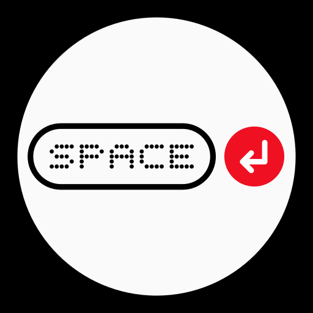
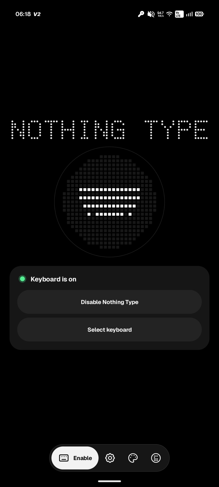
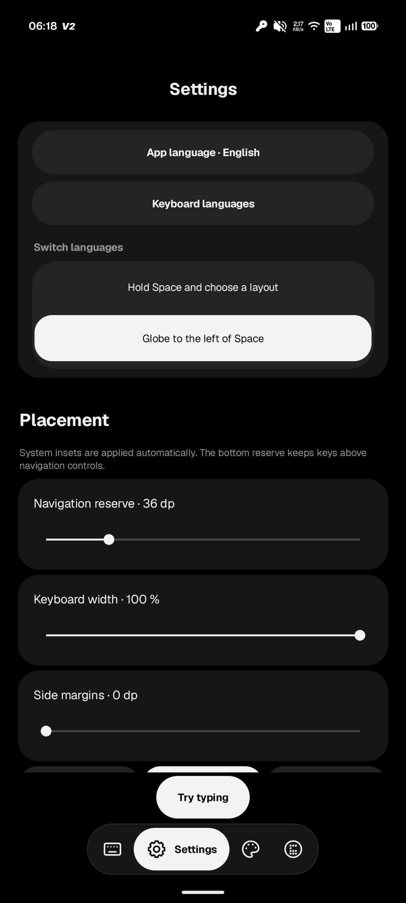
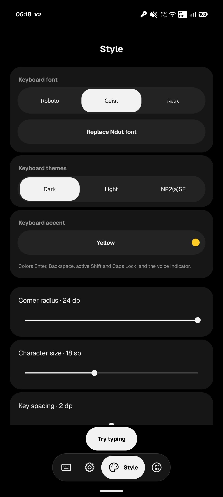
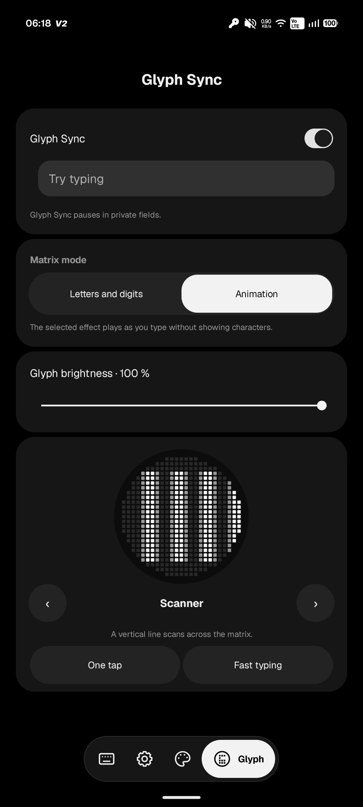

<p align="center"></p>

<h1 align="center">Nothing Type</h1>

<p align="center">An offline-first Android keyboard inspired by Nothing OS.</p>

<p align="center">
  <a href="https://github.com/CVRSPOTTED/nothing-type/releases/download/v0.8.0/nothing-type-0.8.0.apk"><strong>Download APK 0.8.0</strong></a>
  · <a href="https://github.com/CVRSPOTTED/nothing-type/releases/tag/v0.8.0">Release notes</a>
  · <a href="README.ru.md">Русский</a>
</p>

<p align="center">Android 8.0+ · 9 languages · <a href="LICENSE">MIT</a></p>

## Screenshots

<p align="center">
  <a href="screenshots/0.8.0/enable.png"></a>
  <a href="screenshots/0.8.0/settings.png"></a>
  <a href="screenshots/0.8.0/style.png"></a>
</p>

The screenshots were taken on a Phone (3) running the experimental build with the Glyph tab.

## Features

- **Nine interface languages and keyboard layouts.** Arabic, English, French, German, Hindi, Italian, Russian, Spanish and Turkish. Choose the app language separately from the typing layouts.
- **Offline suggestions and autocorrect.** Each built-in layout has a 10,000-entry dictionary. Add your own words, undo corrections with Backspace, and switch layouts with the globe key or by holding Space. Import a KLC file for a custom layout.
- **Typing tools.** Slide across Space to move the cursor, hold a key for alternate characters, browse 3,781 emoji, paste from the clipboard, or dictate through Android’s speech service.
- **Appearance and feedback.** Dark, Light and NP2(a)SE, four accent choices, Roboto and Geist, and Ndot import from ZIP, TTF or OTF. Adjust key size, spacing and position, or enable haptics and a glow that responds to dictation.

Word suggestions stay on the device. Nothing Type keeps no typing history. Android’s speech service may need internet access. [Privacy policy](PRIVACY.md)

## Install

1. [Download the signed 0.8.0 APK](https://github.com/CVRSPOTTED/nothing-type/releases/download/v0.8.0/nothing-type-0.8.0.apk) and open it on Android.
2. Open Nothing Type, turn it on under **Enable** and select it as your keyboard.
3. Choose layouts in **Settings** and customize the keyboard in **Style**. Both tabs have a **Try typing** button.

Version 0.8.0 is a pre-release. The Android 8 automated check for switching to a password field is still failing. [Setup and FAQ](docs/SETUP.md) · [Android checks](https://github.com/CVRSPOTTED/nothing-type/actions/runs/44664793512) · [All releases](https://github.com/CVRSPOTTED/nothing-type/releases)

## Glyph Sync experiment

<p align="center">
  <a href="screenshots/0.8.0/glyph-sync.png"></a>
</p>

On Nothing Phone (3), Glyph Sync can show the last letter or digit with Sparks, or play Pulse or Scanner while you type. The Glyph tab includes brightness and animation previews. This feature is available in a local experimental build with Nothing’s Glyph Matrix SDK. [Glyph Sync build instructions](docs/BUILD.md#glyph-sync-на-nothing-phone-3)

## Build and contribute

With JDK 17 and Android SDK 36, run the tests and build a debug APK.

```sh
bash ./gradlew testDebugUnitTest :swipe-research:test lintDebug assembleDebug
```

On Windows, run the same tasks with `gradlew.bat`. [Build guide](docs/BUILD.md) · [Report an issue](https://github.com/CVRSPOTTED/nothing-type/issues) · [Changelog](CHANGELOG.md) · [Roadmap](docs/ROADMAP.md)

The app code uses the [MIT license](LICENSE). The word lists are licensed under [CC BY-SA 4.0](app/src/main/assets/dictionaries/SOURCE.md). [Third-party licenses](THIRD_PARTY.md)
