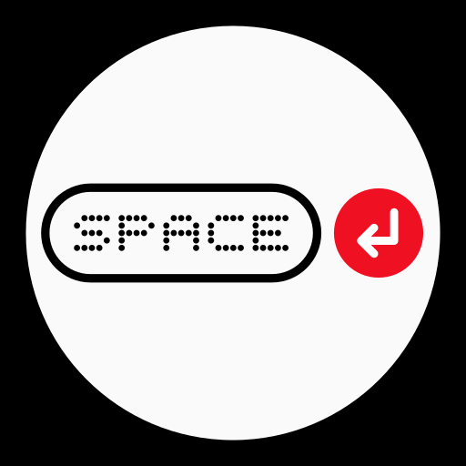
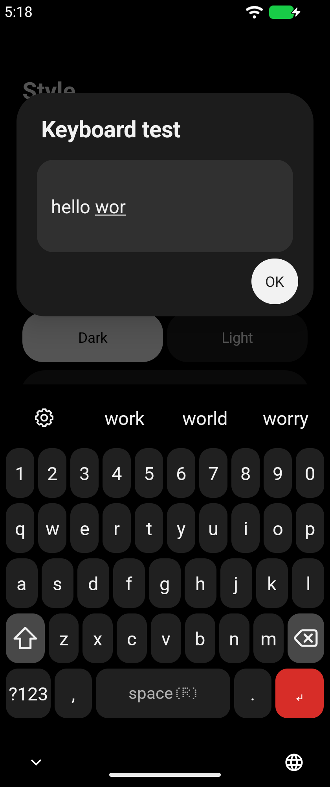
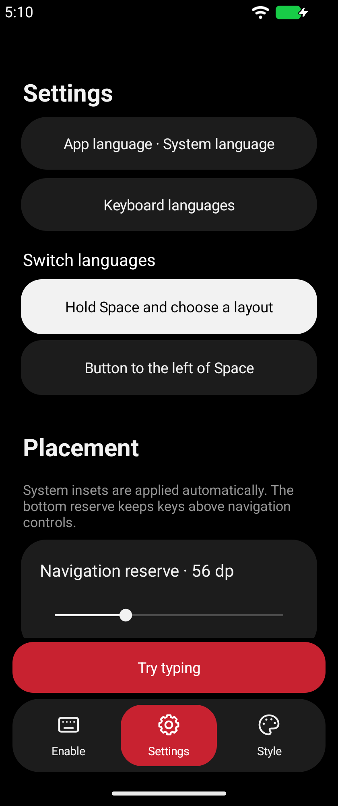
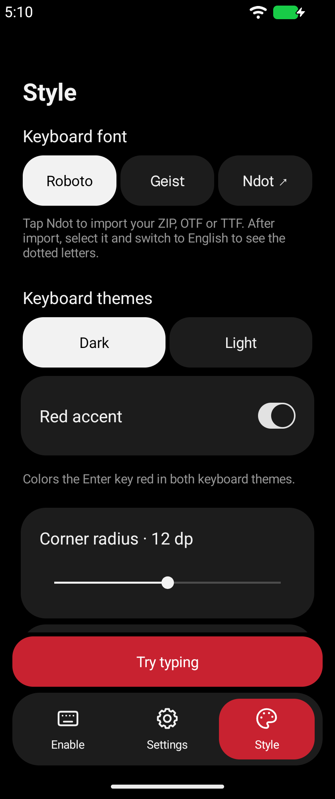

<p align="center"></p>

<h1 align="center">Nothing Type</h1>

<p align="center">An open-source Android keyboard inspired by Nothing OS.</p>

<p align="center">
  <a href="https://github.com/CVRSPOTTED/nothing-type/releases/download/v0.7.0/nothing-type-0.7.0.apk"><strong>Download APK 0.7.0</strong></a> ·
  <a href="https://github.com/CVRSPOTTED/nothing-type/releases">All releases</a> ·
  <a href="README.ru.md">Русский</a>
</p>

[](https://github.com/CVRSPOTTED/nothing-type/actions/workflows/android.yml)

## Screenshots

| Typing | Settings | Style |
| :---: | :---: | :---: |
|  |  |  |

## Features

### Typing and languages

- Eight app languages and keyboard layouts covering English, Russian, French, German, Hindi, Arabic, Turkish and Spanish.
- Offline suggestions and autocorrect with 10,000 dictionary entries per built-in layout. Add your own words and undo a correction with Backspace.
- Switch languages by holding Space or tapping a dedicated key. Import a KLC file for a custom layout.

### Editing and voice

- Slide across Space to move the cursor. Hold keys for alternate characters or hold Backspace to repeat deletion.
- Pick from 3,781 emoji, paste from the clipboard or dictate using Android’s speech service. Dictation may require internet access.
- Suggestions stay on your device. Nothing Type keeps no typing history. See the [privacy policy](PRIVACY.md).

### Appearance and feedback

- Dark and light keyboards, an optional red Enter key, Roboto and Geist, and Ndot font import.
- Adjust key height, spacing, corner radius and keyboard position. Try your changes from the app.
- Optional vibration and a keyboard glow that reacts to your voice during dictation.

## Install

1. Download and install the [signed APK](https://github.com/CVRSPOTTED/nothing-type/releases/tag/v0.7.0). The minimum OS version is Android 8.0.
2. Open Nothing Type. On **Enable**, turn on the keyboard in Android settings, then select it as your input method.
3. Use **Settings** for languages and typing, and **Style** for appearance. Tap **Try typing** to test your changes.

## Build locally

With JDK 17 and Android SDK 36, run the checks and build a debug APK.

```sh
bash ./gradlew testDebugUnitTest :swipe-research:test lintDebug assembleDebug
```

On Windows, run the same tasks with `gradlew.bat`. See the [build guide](docs/BUILD.md) for SDK setup.

| Path | Contents |
| --- | --- |
| `app/` | Android app, keyboard and tests |
| `swipe-research/` | Experimental swipe decoder |
| `docs/` | Build, testing and release guides |

[Report an issue](https://github.com/CVRSPOTTED/nothing-type/issues) · [Changelog](CHANGELOG.md) · [Third-party licenses](THIRD_PARTY.md)

The app code uses the [MIT license](LICENSE). The bundled word lists use [CC BY-SA 4.0](app/src/main/assets/dictionaries/SOURCE.md).
