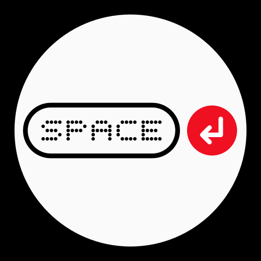
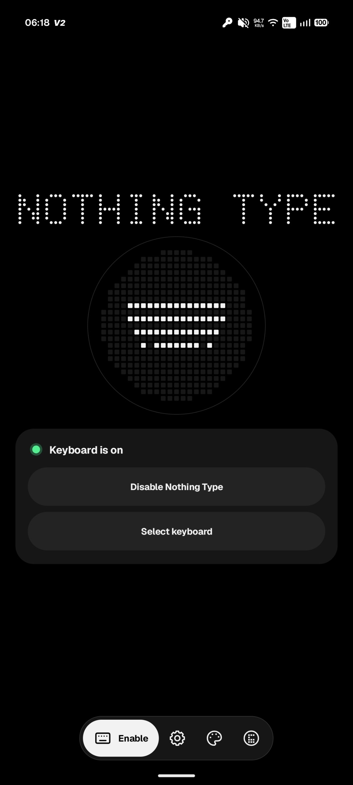
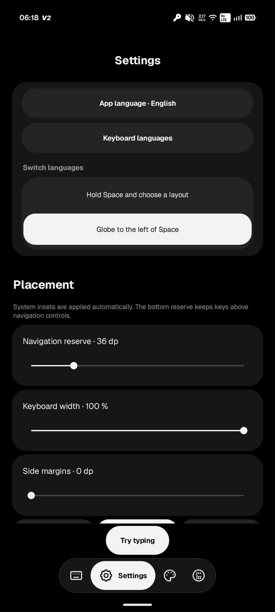
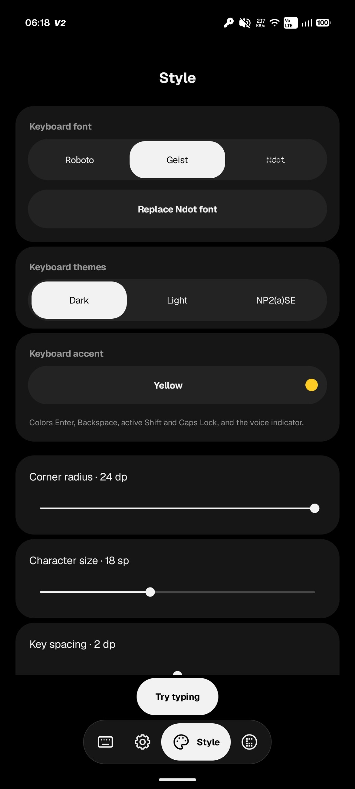
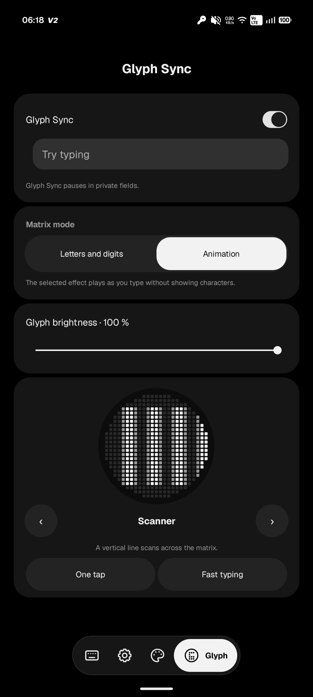

<p align="center"></p>

<h1 align="center">Nothing Type</h1>

<p align="center">Клавиатура для Android в стиле Nothing OS с офлайн-подсказками.</p>

<p align="center">
  <a href="https://github.com/CVRSPOTTED/nothing-type/releases/download/v0.8.0/nothing-type-0.8.0.apk"><strong>Скачать APK 0.8.0</strong></a>
  · <a href="https://github.com/CVRSPOTTED/nothing-type/releases/tag/v0.8.0">Описание релиза</a>
  · <a href="README.md">English</a>
</p>

<p align="center">Android 8.0+ · 9 языков · <a href="LICENSE">MIT</a></p>

## Скриншоты

<p align="center">
  <a href="screenshots/0.8.0/enable.png"></a>
  <a href="screenshots/0.8.0/settings.png"></a>
  <a href="screenshots/0.8.0/style.png"></a>
</p>

Скриншоты сделаны на Phone (3) в экспериментальной сборке с вкладкой Glyph.

## Возможности

- **Девять языков интерфейса и клавиатуры.** Английский, арабский, испанский, итальянский, немецкий, русский, турецкий, французский и хинди. Язык приложения выбирается отдельно от раскладок.
- **Офлайн-подсказки и автоисправление.** В каждой встроенной раскладке по 10 000 слов. Можно добавить свои слова и отменить исправление клавишей Backspace. Раскладки переключаются глобусом или удержанием пробела. Для своих раскладок есть импорт KLC.
- **Инструменты набора.** Веди пальцем по пробелу, чтобы переместить курсор, удерживай клавишу для допсимволов, выбирай из 3 781 эмодзи, вставляй из буфера или диктуй через Android.
- **Оформление и отклик.** Тёмная, светлая и NP2(a)SE, четыре акцента, Roboto, Geist и импорт Ndot из ZIP, TTF или OTF. Можно настроить размер, промежутки и положение клавиш, включить вибрацию или свечение при диктовке.

Подсказки работают на устройстве. Клавиатура не сохраняет историю набора. Службе распознавания речи Android может потребоваться интернет. [Приватность](PRIVACY.md)

## Установка

1. [Скачай подписанный APK 0.8.0](https://github.com/CVRSPOTTED/nothing-type/releases/download/v0.8.0/nothing-type-0.8.0.apk) и открой его на Android.
2. Открой Nothing Type, включи клавиатуру на вкладке **«Включение»** и выбери её как способ ввода.
3. Выбери раскладки в **«Настройках»**, а оформление — в **«Стиле»**. На обеих вкладках есть кнопка **«Проверить ввод»**.

Версия 0.8.0 — предварительный релиз. На Android 8 пока падает автоматический тест перехода в парольное поле. [Настройка и FAQ](docs/SETUP.ru.md) · [Проверки Android](https://github.com/CVRSPOTTED/nothing-type/actions/runs/44664793512) · [Все релизы](https://github.com/CVRSPOTTED/nothing-type/releases)

## Экспериментальный Glyph Sync

<p align="center">
  <a href="screenshots/0.8.0/glyph-sync.png"></a>
</p>

На Nothing Phone (3) Glyph Sync показывает последнюю букву или цифру с искрами либо запускает «Импульс» или «Сканер» при наборе. На вкладке Glyph можно настроить яркость и посмотреть эффекты. Функция доступна в локальной экспериментальной сборке с Glyph Matrix SDK от Nothing. [Инструкция по сборке Glyph Sync](docs/BUILD.md#glyph-sync-на-nothing-phone-3)

## Сборка и участие

Для тестов и отладочной сборки нужны JDK 17 и Android SDK 36.

```sh
bash ./gradlew testDebugUnitTest :swipe-research:test lintDebug assembleDebug
```

В Windows те же задачи запускаются через `gradlew.bat`. [Инструкция по сборке](docs/BUILD.md) · [Сообщить об ошибке](https://github.com/CVRSPOTTED/nothing-type/issues) · [История изменений](CHANGELOG.md) · [Дорожная карта](docs/ROADMAP.md)

Код приложения распространяется по [MIT](LICENSE), словари — по [CC BY-SA 4.0](app/src/main/assets/dictionaries/SOURCE.md). [Лицензии компонентов](THIRD_PARTY.md)
